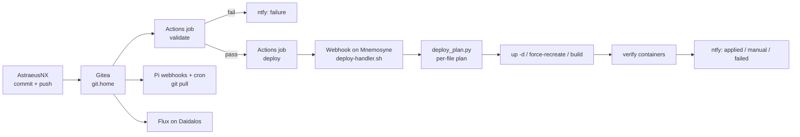

# homelab-gitops

[](https://github.com/Andre-A-Dev/homelab-gitops/actions/workflows/validate.yml)

Infrastructure-as-code and GitOps source of truth for a self-hosted, privacy-first homelab: Docker Compose stacks on a Raspberry Pi 5, DNS and monitoring satellites on Pi 3s, and a single-node k3s learning cluster reconciled by Flux. Every push is validated in CI and deployed per changed file. No plaintext secrets in tracked files.

## Highlights

- **CI-gated push-to-deploy.** A push runs validation first; only then a deploy job triggers the host. A per-file plan decides what each changed file needs (`up -d`, `--force-recreate` for changed bind-mounted config, rebuild for changed build contexts), verifies the touched containers and reports anything that needs a human.
- **Policy enforced in CI.** Compose config, alert rules, dashboards, `.env.example` drift, update-class labels, the allowed Compose profiles, shellcheck, executable bits and suppressed error output are all checked before anything deploys.
- **Backups that are checked, not assumed.** Nightly local backup, encrypted and deduplicated restic offsite copy, daily verification, weekly prune and integrity check. Each backup unit reports start and result to Healthchecks.io.
- **Monitoring that watches itself.** Prometheus, Alertmanager, Grafana and Loki, with alerts for stale metrics, missing exporters and a Watchdog that must keep firing.
- **Kubernetes on the side.** A single-node k3s cluster reconciled by Flux, for learning; production stays on Compose.
- **Own code where nothing fit.** Exporters for Shelly plugs, the Prusa printer and the Viessmann heating (read over an optical serial link), a weather console and a touch panel for the rack front.

## About this repository

The public GitHub repository is a sanitized mirror of a private Gitea repository, which is the actual source of truth and deploy target. Internal IPs, domains and personal data are replaced with placeholders (`192.168.1.x`, `yourdomain.dedyn.io`), a few private files are left out, and the full commit history stays private.

---

## Hosts

| Host | Device | Role | IP | Tailscale IP |
|---|---|---|---|---|
| **Mnemosyne** | Raspberry Pi 5 (8 GB, arm64) | Primary server, almost all stacks | `192.168.1.10` | `100.x.x.x` |
| **Boreas** | Raspberry Pi 3B (arm32) | DNS + ad blocking (home network) | `192.168.1.11` | — |
| **Zephyros** | Raspberry Pi 3B+ (arm64) | DNS + ad blocking, reverse proxy (remote network) | `192.168.1.11`* | `100.y.y.y` |
| **Hephaestus** | Raspberry Pi 3B (arm32) | Viessmann heating integration | `192.168.1.13` | — |
| **Daidalos** | Dell OptiPlex 7070 Micro (i5-9500T, 16 GB, x86_64) | Single-node k3s learning cluster, Flux | `192.168.1.x` | — |
| **AstraeusNX** | Desktop PC (Ryzen 9 9950X3D, RTX 5080, 64 GB) | Primary workstation, CachyOS (Windows 11 dual-boot for a few exceptions) | `192.168.1.x` | — |
| **Proteus** | Acer Switch Alpha 12 (N16P3) | Secondary workstation, mobile, CachyOS | DHCP | — |

> \* Zephyros is on a separate network at a different location.

Mnemosyne and Daidalos sit in a self-printed 5U rack with its own switch. A 2U touch panel on its front (`rack-display` stack) shows the live state of the homelab and is mirrored at `https://rack.home`.

---

## Repository Layout

```
homelab-infra/
├── .gitea/workflows/               # CI: validate + deploy, nightly backup verification
├── clusters/daidalos/              # Kubernetes manifests, reconciled by Flux
├── shared/
│   ├── scripts/                    # Multi-host scripts — hostname-dispatched, symlinked to /usr/local/bin/
│   ├── dotfiles/                   # fish, ssh_config for all homelab hosts
│   ├── apticron/                   # apticron.conf for all Pis
│   └── compose-profiles.yml        # Allowed Compose profiles per host (CI-enforced)
├── mnemosyne/
│   ├── stacks/                     # One Compose stack per service — index: mnemosyne/stacks/README.md
│   ├── scripts/                    # Deploy handler, backup/restore, restic, drift check, textfile exporters
│   ├── systemd/                    # Units grouped by topic (backup/, restic/), drop-ins next to their unit
│   ├── docker/                     # daemon.json
│   └── webhook/                    # Deploy webhook config template
├── boreas/                         # Caddy (standby), node-exporter, pihole6-exporter, backup script
├── zephyros/                       # Caddy, monitoring (node + Fritz exporters), Pi-hole config, scripts
├── hephaestus/                     # vcontrold, Viessmann exporter + API, status display, node-exporter
├── daidalos/                       # Host bootstrap (Debian 13 + k3s), node-exporter config
├── astraeus_nx/                    # CachyOS workstation: Ollama, hardware health checks
├── astraeus/                       # Windows: diagnostics script
└── scripts/                        # Repo tooling: public mirror export, secret audit, repo tree
```

Most directories carry their own `README.md` with details.

---

## Services

### Mnemosyne

| Service | Access | Stack |
|---|---|---|
| Caddy | `:80`, `:443` | `caddy/` |
| Vaultwarden | `https://vault.home` | `vaultwarden/` |
| Nextcloud | `https://cloud.yourdomain.dedyn.io` | `nextcloud/` |
| Gitea | `https://git.home` | `gitea/` |
| Ghost | `https://blog.yourdomain.dedyn.io` | `ghost/` |
| Ghostwrite | `https://ghostwrite.home` | `ghostwrite/` |
| GhostProxy | `https://ghostproxy.home` | `ghostproxy/` |
| Immich | `https://immich.home` | `immich/` |
| Calibre-Web | `https://calibre.home` | `calibre/` |
| KOSync | `https://kosync.home` | `calibre/` |
| Wakapi | `https://wakapi.home` | `wakapi/` |
| Aether | `https://weather.home` | `aether/` |
| Jobiris | `https://jobiris.home` | `jobiris/` |
| Carousel | `https://carousel.home` | `carousel/` |
| Rack display mirror | `https://rack.home` | `rack-display/` + systemd |
| Grafana | `https://grafana.home` | `monitoring/` |
| Prometheus | `https://prometheus.home` | `monitoring/` |
| Alertmanager | `https://alertmanager.home` | `monitoring/` |
| Alloy | `https://alloy.home` | `monitoring/` |
| Syncthing | `https://syncthing.home` | systemd |

Caddy on Mnemosyne also proxies the Pi-hole admin UIs (`pihole.home`, `pihole-zephyros.home`) and the remote FritzBox (`fritz-zephyros.home`).

### Boreas

| Service | Port | Notes |
|---|---|---|
| Pi-hole v6 | `80` (web UI) | DNS filtering, native install |
| Unbound | `5335` | Upstream for Pi-hole, native install |
| Node Exporter | `9100` | Docker |
| Pi-hole Exporter | `9666` | systemd service |
| Caddy | `443` | Docker, standby |

### Zephyros

| Service | Port | Notes |
|---|---|---|
| Pi-hole v6 | `80` (web UI) | DNS filtering at remote location |
| Unbound | `5335` | Local resolution |
| Caddy | `443` | Reverse proxy → Mnemosyne via Tailscale |
| Node Exporter | `9100` | Scraped by Prometheus on Mnemosyne via Tailscale |
| Pi-hole Exporter | `9666` | systemd service, scraped via Tailscale |
| Fritz Exporters | `9787`, `9042` | FritzBox metrics at remote location |

### Hephaestus

| Service | Access | Notes |
|---|---|---|
| vcontrold | `127.0.0.1:3002` | Viessmann KW2 daemon, localhost only |
| Viessmann Control API | port `8081` | Write API behind a Grafana control panel. **Disabled** after errors when writing values to the boiler; Caddy route `viessmann.home` commented out |
| Status display | framebuffer | Heating, network and service pages |
| Node Exporter | `9100` | Textfile collector for Viessmann metrics |

### Daidalos

| Service | Port | Notes |
|---|---|---|
| k3s | `6443` | Single node, traefik + servicelb disabled |
| Flux | — | Reconciles `clusters/daidalos/` from Gitea |
| Node Exporter | `9100` | Debian package |
| smartctl Exporter | `9633` | Debian package |

### AstraeusNX

| Directory | Contents |
|---|---|
| `astraeus_nx/stacks/ollama/` | Local LLM runtime |
| `astraeus_nx/scripts/health_checks/` | Hardware health checks (disk, RAM, GPU, AIO) |
| `astraeus/scripts/win_diag/` | Windows diagnostics script for the Windows boot |

AstraeusNX runs Node Exporter on CachyOS and the Windows Exporter (port `9182`) when booted into Windows, both scraped by Prometheus on Mnemosyne.

The workstation dotfiles (KDE, OpenRGB, CoolerControl) are version-controlled in this repository as well and symlinked into place by an install script. They are personal and not published to the public mirror; the shared shell config is in `shared/dotfiles/`.

Full service, DNS and storage reference: [`SERVICES.md`](SERVICES.md).

---

## Secrets

Each stack that requires credentials ships with a `.env.example` file. Copy it to `.env` on the target host and fill in the values before starting the stack. CI fails if a compose file uses a key that is missing from `.env.example`.

```bash
cp .env.example .env
nano .env
```

`.env` files are listed in `.gitignore` and are never committed.

---

## Workflow

All changes are made on AstraeusNX and pushed to Gitea. Nothing is edited on a server.

- **Mnemosyne:** the Actions job `validate` checks every push (compose config, update-class labels, alert rules, Prometheus/Alertmanager configs, Grafana JSON, `.env.example` drift, shellcheck, executable bits, suppressed error output). Only if it passes, the job `deploy` calls the host webhook. `deploy-handler.sh` fast-forwards to exactly the validated commit and applies a per-file plan from `deploy_plan.py`: `docker compose up -d` for changed compose files, `--force-recreate` for services whose bind-mounted config changed, a rebuild for changed build contexts. It then verifies the touched containers. Changes it must not apply itself (Gitea and its runner, systemd units, unmounted files) are reported as manual follow-ups.
- **Boreas, Zephyros, Hephaestus:** a Gitea webhook plus a 15-minute cron pull (`shared/scripts/gitea-webhook-handler.sh`, `gitea-pull.sh`). Zephyros applies its Caddy and monitoring stacks; the others restart specific systemd services.
- **Daidalos:** Flux reconciles `clusters/daidalos/`. A push there is a deploy.



See `.gitea/workflows/validate.yml`, `mnemosyne/scripts/deploy-handler.sh` and `mnemosyne/scripts/deploy_plan.py`. Manual operations (updates, restores, troubleshooting) are in [`RUNBOOK.md`](RUNBOOK.md); design decisions in [`ARCHITECTURE.md`](ARCHITECTURE.md).

---

## DNS

Internal DNS is handled by Pi-hole v6 + Unbound on Boreas. All `.home` domains resolve to `192.168.1.10`. Zephyros runs its own Pi-hole for the remote network. External access to `cloud.yourdomain.dedyn.io` and `blog.yourdomain.dedyn.io` via deSEC dynamic DNS.

All internal services are behind Caddy with its internal CA. Import `caddy-root.crt` on any client that needs to trust `.home` domains over HTTPS.

---

## Monitoring

Prometheus on Mnemosyne scrapes all hosts and services, Grafana runs at `https://grafana.home`. Alloy ships container logs and the systemd journal to Loki. Alertmanager notifies via ntfy; its Watchdog alert feeds a dead man's switch on Healthchecks.io, which also tracks the backup and restic units.

| Target | Exporter | Runs on |
|---|---|---|
| Host metrics (all servers + workstations) | Node Exporter | each host |
| Disk health | smartctl_exporter | Mnemosyne, Daidalos |
| Containers | cAdvisor | Mnemosyne |
| Container logs + journal | Alloy → Loki | Mnemosyne |
| Pi-hole v6 | pihole6-exporter | Boreas, Zephyros |
| HTTP uptime + TLS | Blackbox Exporter | Mnemosyne |
| FritzBox (home) | fritz-exporter | Mnemosyne |
| FritzBox (remote) | fritz-exporter, fritzbox-lua exporter | Zephyros |
| Netatmo weather | netatmo-exporter | Mnemosyne |
| Tado heating | tado-exporter | Mnemosyne |
| Shelly plugs | shelly-exporter | Mnemosyne |
| Nextcloud | nextcloud-exporter | Mnemosyne |
| Gitea | built-in `/metrics` | Mnemosyne |
| Wakapi coding stats | built-in `/api/metrics` | Mnemosyne |
| Prusa MK4S (Pygmalion) | prusa-exporter | Mnemosyne |
| Windows (AstraeusNX, Windows boot) | Windows Exporter | AstraeusNX |
| Viessmann heating | textfile collector | Hephaestus |
| Fan level, Tailscale, image updates, backup runs, rack display heartbeat | textfile collector | Mnemosyne |

Grafana dashboard JSON exports are kept under `mnemosyne/stacks/monitoring/grafana/dashboards/` as a backup; the live Grafana instance is authoritative.

---

## Backup

`backup-services.sh` runs daily at 02:00 on Mnemosyne (systemd timer) and writes all Docker volumes and host-mounted data paths to a WD My Passport USB SSD at `/mnt/backup`. On success it triggers `restic-offsite.service`, which pushes the backup to a Hetzner Storage Box as an encrypted, deduplicated restic repository; a 06:00 timer acts as fallback. `verify-backup` checks the local archives at 04:00, `restic-maintenance` prunes and checks the offsite repository weekly.

Run manually with `sudo /usr/local/bin/backup-services.sh`; `--no-offsite` skips the restic trigger. Restore procedures: [`RUNBOOK.md`](RUNBOOK.md).
