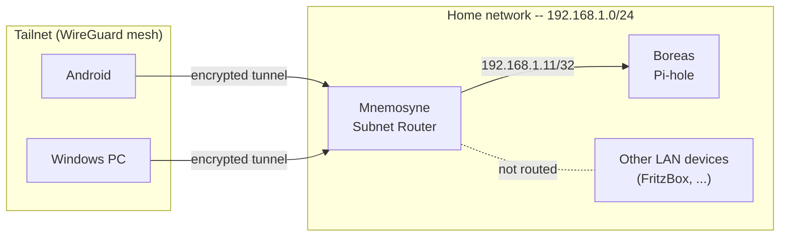

# Tailscale

Tailscale connects all devices into an encrypted WireGuard mesh network without port forwarding or firewall changes. Mnemosyne acts as a subnet router for exactly two LAN addresses, its own and Boreas', so `.home` names (which Pi-hole resolves to LAN IPs) and the split DNS for `home` work from anywhere. The rest of the home LAN is deliberately not routed.

---

## Architecture

```
Tailnet (100.x.x.x)
├── Mnemosyne      ← Subnet Router for 192.168.1.10/32 (itself) and 192.168.1.11/32 (Boreas)
├── Boreas
├── Zephyros       (tag:remote, restricted, see Security considerations)
├── Windows PC
└── Android

Reachable via Subnet Router by LAN IP:
├── Mnemosyne      (192.168.1.10)  ← .home names resolve here
└── Boreas         (192.168.1.11)  ← split DNS target for "home"

Not routed: FritzBox, smart plugs, printer and every other LAN device.
```



**Why two `/32` routes instead of the whole `/24`?** Only these two addresses are needed remotely. A `/24` route would expose the FritzBox and every device without a login to the whole Tailnet, and the remote site uses the same `192.168.1.0/24`: a client there that accepts the route would send its local LAN traffic into the tunnel.

**Why not WireGuard directly on the FritzBox?** Tailscale establishes peer-to-peer tunnels -- traffic goes directly between devices without routing through a central hub. For video streaming use cases this matters significantly. The coordination server (Tailscale's infrastructure) only handles key exchange and NAT traversal; it never sees traffic.

---

## Configuration reference

| Parameter | Value |
|---|---|
| Install method | apt (via Tailscale repository) |
| Service | systemd (`tailscaled.service`) |
| Subnet Router | `192.168.1.10/32`, `192.168.1.11/32` (advertised by Mnemosyne) |
| Split DNS | `home` → Boreas' LAN IP (`192.168.1.11`), reached via the `/32` route |
| MagicDNS | Disabled -- Pi-hole handles DNS |
| Free tier | Up to 100 devices, 3 users |

---

## Installation

### Linux (Mnemosyne, Boreas, Zephyros)

```bash
curl -fsSL https://tailscale.com/install.sh | sh
```

This sets up an apt repository -- subsequent updates come through `apt upgrade` like any other package.

```bash
tailscale version
systemctl status tailscaled
```

### Enable IP forwarding (subnet router only)

Mnemosyne needs to forward packets for other LAN devices. This is not required on Boreas or Zephyros.

```bash
echo 'net.ipv4.ip_forward = 1' | sudo tee -a /etc/sysctl.d/99-tailscale.conf
echo 'net.ipv6.conf.all.forwarding = 1' | sudo tee -a /etc/sysctl.d/99-tailscale.conf
sudo sysctl -p /etc/sysctl.d/99-tailscale.conf

# Verify
sysctl net.ipv4.ip_forward
# Expected: net.ipv4.ip_forward = 1
```

### Authenticate and advertise routes

```bash
# Subnet router (Mnemosyne)
sudo tailscale up --advertise-routes=192.168.1.10/32,192.168.1.11/32

# Regular node (Boreas, Zephyros)
sudo tailscale up
```

Open the URL shown in the output, log in with your Tailscale account, approve the device.

Then approve the subnet routes in the admin console:

```
https://login.tailscale.com/admin/machines
→ Mnemosyne → Edit route settings → Approve both /32 routes
```

Without approval in the admin console, `--advertise-routes` is just an announcement -- no packets are forwarded.

### Persistence across reboots

Nothing to do: `tailscaled` stores the advertised routes in its state and applies them on start (journal after a reboot: `using backend prefs ... routes=[...]`). An older version of this page described a `tailscale-up.service` oneshot unit; it is not needed and not installed. Change the routes with `sudo tailscale set --advertise-routes=...`, check them with `tailscale debug prefs | grep -A3 AdvertiseRoutes`.

### Windows

Download from [tailscale.com/download/windows](https://tailscale.com/download/windows), install, log in via the system tray icon.

### Android

Install from the Play Store. After connecting, disable battery optimization for the app -- Android aggressively kills background services:

```
Settings → Apps → Tailscale → Battery → Unrestricted
```

---

## DNS: Pi-hole over Tailscale

Tailscale has its own DNS feature (MagicDNS). Running both MagicDNS and Pi-hole simultaneously causes conflicts. The recommended setup:

**Disable MagicDNS** and use Pi-hole as the DNS server for the entire Tailnet:

```
Tailscale Admin → DNS → MagicDNS → Disable
Tailscale Admin → DNS → Global nameservers → add Boreas' Tailscale IP
```

This gives DNS filtering on all devices even when away from home, and `.home` domains resolve correctly everywhere in the Tailnet.

Add a fallback nameserver (`1.1.1.1` or `9.9.9.9`) so DNS still works if Boreas is unreachable.

---

## How the subnet router works

```
Without subnet router:          With subnet router:

Tailnet                         Tailnet
├── Mnemosyne  ✅               ├── Mnemosyne  ✅ (also by LAN IP)
├── Android    ✅               ├── Android    ✅
├── Boreas LAN ❌               ├── Boreas LAN ✅ (via Mnemosyne)
└── FritzBox   ❌               └── FritzBox   ❌ (not routed on purpose)
```

Android accepts subnet routes by default; Linux clients only with `--accept-routes`.

Packet flow from Android to Boreas' LAN IP (`192.168.1.11`, split DNS):

1. Android's routing table: `192.168.1.11/32` is reachable via Mnemosyne in the Tailnet
2. Packet is encrypted and sent peer-to-peer to Mnemosyne (WireGuard)
3. Mnemosyne decrypts and forwards into the LAN (normal IP routing)
4. LAN device receives the packet -- sees Mnemosyne's LAN IP as source

---

## Security considerations

**Tailnet membership equals LAN trust.** Mnemosyne's Caddy (`lan_only`) treats every `100.64.0.0/10` address like the home LAN, so any untagged device in the Tailnet can open every `.home` site, including those without a login of their own. The network layer is already narrow: Mnemosyne advertises only two `/32` routes (itself and Boreas), not the whole LAN, so the FritzBox, smart plugs and the printer are not reachable via Tailscale. Neither Serve nor Funnel is configured. The remaining risk is who can join the Tailnet and which `.home` services lack authentication, not open ports.

### Policy: Zephyros is tagged and restricted

Zephyros sits at a remote site and is the one node outside the home. It carries `tag:remote`, which takes it out of `autogroup:member`, so the unrestricted grant no longer covers it. It may only open the connections it needs itself; connections *to* Zephyros (Prometheus scrapes, Caddy upstreams, Gitea webhook) come from untagged devices and stay allowed. Tagged nodes have no key expiry.

The policy lives only in the admin console (Access controls → JSON editor); this is a copy for review:

```jsonc
{
  "hosts": {
    "mnemosyne": "100.x.x.x",
    "boreas":    "100.x.x.x",
    "zephyros":  "100.y.y.y",
  },
  "tagOwners": { "tag:remote": ["autogroup:admin"] },
  "grants": [
    // Own (untagged) devices: unrestricted, incl. the subnet route
    {"src": ["autogroup:member"], "dst": ["*"], "ip": ["*"]},
    // Zephyros -> Mnemosyne: Caddy upstream (443), backup via rrsync-only key (22), git pull (2222)
    {"src": ["tag:remote"], "dst": ["mnemosyne"], "ip": ["tcp:22", "tcp:443", "tcp:2222"]},
    // Zephyros -> Boreas: Tailscale DNS, Boreas is the first resolver
    {"src": ["tag:remote"], "dst": ["boreas"], "ip": ["udp:53", "tcp:53"]},
  ],
  "ssh": [
    {"action": "check", "src": ["autogroup:member"], "dst": ["autogroup:self"],
     "users": ["autogroup:nonroot", "root"]},
  ],
  "tests": [
    {"src": "tag:remote",
     "accept": ["mnemosyne:443", "mnemosyne:22", "mnemosyne:2222", "boreas:53"],
     "deny":   ["mnemosyne:8384", "mnemosyne:9000", "mnemosyne:3000", "<daidalos-ts-ip>:22"]},
    // Mnemosyne stands in for all untagged devices (tests reject autogroups as src)
    {"src": "mnemosyne",
     "accept": ["zephyros:9100", "zephyros:9666", "zephyros:9787", "zephyros:9042",
                "zephyros:443", "zephyros:8081", "zephyros:9000"]},
  ],
}
```

- **Zephyros needs a new connection** (new service, new scrape direction): add it to its grant *and* to the `tests` block, so the console rejects a policy that breaks it.
- **Something on Zephyros broke after a policy change:** remove `tag:remote` from Zephyros (Machines → zephyros → Edit ACL tags). It falls back into `autogroup:member` immediately; the policy can stay.
- **Verify from Zephyros:** `timeout 5 bash -c 'exec 3<>/dev/tcp/<mnemosyne-ts-ip>/8384' && echo open || echo closed` must print `closed`, the same for `:443` must print `open`.

---

## Useful commands

```bash
tailscale status                    # all connected devices with their 100.x.x.x IPs
tailscale ip                        # this device's Tailscale IP
tailscale ping 100.x.x.x            # test connectivity to a device
tailscale ping --verbose 100.x.x.x  # direct vs. DERP relay
tailscale netcheck                  # network diagnostics
journalctl -u tailscaled -f         # daemon logs
sudo tailscale down                 # disconnect (without uninstalling)
sudo tailscale up --advertise-routes=192.168.1.10/32,192.168.1.11/32   # reconnect (repeat every non-default flag)
tailscale set --hostname=mnemosyne  # rename this device
```

---

## Troubleshooting

| Symptom | Cause | Fix |
|---|---|---|
| LAN device not reachable via Tailscale | Subnet route not approved | Admin console → Mnemosyne → Edit route settings → Approve |
| Subnet route missing | Routes dropped by a `tailscale up` without `--advertise-routes` | `tailscale debug prefs \| grep -A3 AdvertiseRoutes`, then `sudo tailscale set --advertise-routes=...` |
| High latency | No direct peer-to-peer tunnel, using DERP relay | `tailscale ping --verbose` -- check relay vs. direct |
| DNS not resolving in Tailnet | MagicDNS conflict with Pi-hole | Disable MagicDNS, add Pi-hole as global nameserver |
| `.home` domains not resolving remotely | Pi-hole not set as Tailnet DNS | Add Boreas' Tailscale IP as nameserver in admin console |
| `tailscale up` asks for re-authentication | State lost or expired | Open the URL in a browser and log in again |
| Subnet route not visible on clients | IP forwarding not active | `sysctl net.ipv4.ip_forward` -- should be `1` |
| Android disconnects in background | Battery optimization | Settings → Apps → Tailscale → Battery → Unrestricted |
