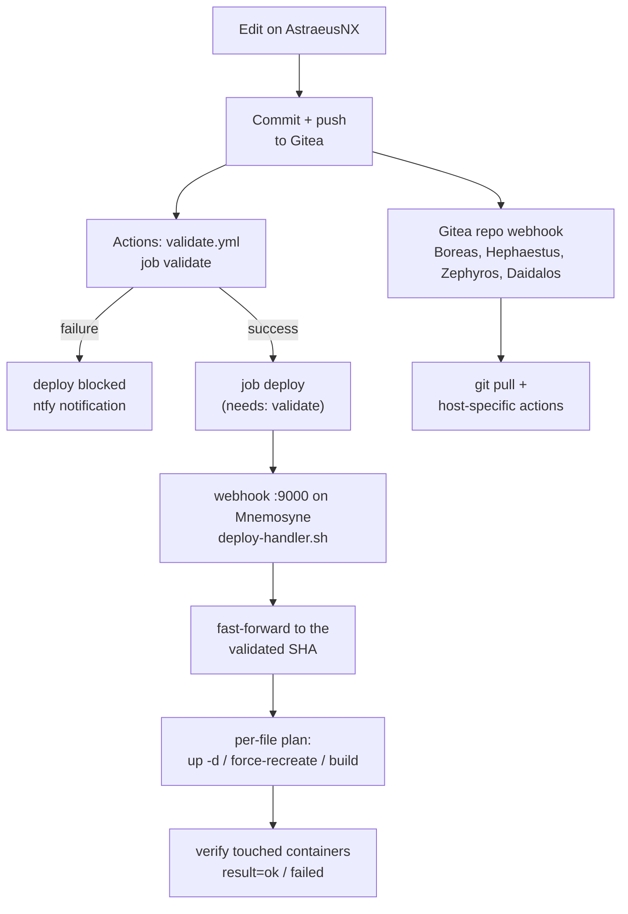

# Workflow

How changes move from the workstation (AstraeusNX) to running containers -- and how CI validates and gates them along the way.

---

## Overview



Mnemosyne deploys only after validation passed, and only the exact commit that was validated. The other Pis pull on every push through their own webhook, independent of CI.

---

## Mnemosyne deploy

The `deploy` job in `validate.yml` signs the commit SHA with an HMAC and calls the webhook listener on the host synchronously. `mnemosyne/scripts/deploy-handler.sh` then:

1. Takes a lock, so two quick pushes cannot interleave.
2. Fast-forwards the checkout to exactly the validated SHA -- never past it, so an unvalidated newer commit cannot ride along. A SHA that is not on `main` or a diverged checkout aborts the deploy.
3. Builds a per-file plan with `mnemosyne/scripts/deploy_plan.py` and applies it.
4. Waits 20 seconds and verifies every touched container: nothing `restarting`, `exited` with a non-zero code, or `unhealthy`.
5. Prints one result line. A failure answers HTTP 500, which turns the job red and sends an ntfy notification.

### What a changed file triggers

| Changed in the commit | Action |
|---|---|
| `docker-compose.yml` of a stack | `docker compose up -d` for that stack -- this also starts a new stack |
| A file a service bind-mounts (`alerts.yml`, Caddyfile, Alertmanager template, ...) | `--force-recreate` of exactly the services mounting it. A reload would keep the old inode. |
| A file in a service's build context (`Dockerfile`, app code) | `docker compose build` + recreate |
| A file no running service mounts or builds from | Nothing; reported as `manual=<stack>:unmapped` |
| `gitea`, `gitea-runner` | Nothing; reported as `manual`. Recreating either kills the running deploy job. |
| `mnemosyne/systemd/` | Nothing; reported as `manual=systemd` |
| A stack directory without `docker-compose.yml` (removed stack) | Nothing; reported as `manual` |
| All services of a stack behind a profile | Nothing; leftover containers are reported, never removed |
| `*.md`, `.env.example`, `grafana/dashboards/` | Ignored |
| Scripts in `mnemosyne/scripts/` and `shared/scripts/` | Active right after the checkout -- `/usr/local/bin/` symlinks into the repo |

Services behind a profile are never named in `up --force-recreate`: that would start them.

### Reading the result

```
time="2026-10-23T18:42:04+0200" level=info event=checkout sha=57d700e before=73e5cf1
time="2026-10-23T18:42:04+0200" level=info event=force_recreate stack=monitoring services=alertmanager,prometheus
time="2026-10-23T18:42:32+0200" level=info result=ok sha=57d700e applied="monitoring" manual="" failed=""
```

Every `manual=` entry needs a step by hand. The full handler output is in the `deploy` job log in Gitea and in the journal on Mnemosyne:

```bash
journalctl -u webhook --since today | grep result=
```

---

## Boreas, Hephaestus, Zephyros

A Gitea repo webhook calls the listener on each Pi, which runs `shared/scripts/gitea-webhook-handler.sh`. A cron job (`gitea-pull.sh`, every 15 minutes) pulls as a fallback. These hosts are not gated by CI.

| Host | After the pull |
|---|---|
| Zephyros | `zephyros/caddy/`: validates the Caddyfile in a one-off container, then `--force-recreate`. `zephyros/monitoring/`: `docker compose up -d`. |
| Boreas | Restarts `pihole6-exporter` when its unit changed. Anything else is manual. |
| Hephaestus | Restarts `vcontrold` when its unit changed. Anything else is manual. |
| Daidalos | Pull only: its shared files are symlinks into the checkout. `clusters/daidalos/` is reconciled by Flux, independent of this webhook. |

The handler logs to `/var/log/webhook-handler.log` on each host.

A new webhook target must be added to `GITEA__security__ALLOWED_HOST_LIST` in `mnemosyne/stacks/gitea/docker-compose.yml` first. Gitea refuses private addresses that are not listed; the delivery then fails with `denied by egress policy` and the host never sees a request.

---

## CI pipeline (`validate.yml`)

Runs on every push to `main` and on pull requests. `deploy` runs for pushes only.

| Step (job `validate`) | Checks | Blocks deploy |
|---|---|---|
| `check_configs.py` | Compose YAML, alert rules, dashboards, profile vocabulary | yes |
| Env drift (`check_env_drift.py`) | `.env.example` vs. `${VAR}` references | yes |
| promcheck | `promtool check config`/`rules`, `amtool check-config` with the tools of the running images | yes |
| shellcheck | all `*.sh` | yes |
| Executable bit | every `*.sh` is `100755` in the index | yes |
| stderr check | unreviewed `2>/dev/null` | no (warning) |

Every check runs with `continue-on-error`, so one failing area cannot hide the others; the `Collect results` step fails the job. Both scripts run locally before pushing:

```bash
python3 .gitea/scripts/check_configs.py
python3 .gitea/scripts/check_env_drift.py
```

### Env drift check

Part of the `validate` job since 2026-10-23 (before that its own workflow, `env-drift.yml`, which ran beside validation and never blocked a deploy). It compares each stack's `.env.example` against the variables referenced in `docker-compose.yml`:

- **missing keys** -- referenced in compose but not documented in `.env.example`
- **dead keys** -- documented in `.env.example` but not referenced in compose (skipped for stacks using `env_file:`)

Stacks that use `env_file: .env` pass the entire file to the container at runtime. Their variables don't appear as `${VAR}` references in compose, so the dead-key check is skipped for them.

### Runner stack

The runner runs in host mode (labels `mnemosyne:host`, `docker:host`, `arm64:host`): jobs execute inside the runner container itself, which reaches the host webhook through `host.docker.internal`.

```
~/stacks/gitea-runner/
├── docker-compose.yml
├── .env               ← GITEA_RUNNER_REGISTRATION_TOKEN, GITEA_CLONE_TOKEN, GITEA_WIKI_TOKEN, NTFY_TOPIC
└── .env.example

/mnt/codex/gitea/runner/
├── .runner            ← auth state after registration (auto-generated)
├── id_ed25519         ← SSH key for the backup-verify workflow
└── ca.crt             ← Caddy root CA (needed to clone from git.home over HTTPS)
```

### Re-register the runner

```bash
cd ~/stacks/gitea-runner
docker compose down
sudo rm -f /mnt/codex/gitea/runner/.runner
# Generate a new token: Gitea → Site Administration → Runners → Create Runner
nano ~/stacks/gitea-runner/.env
docker compose up -d
docker logs gitea-act-runner -f
# Expected: "Runner registered successfully."
```

The registration token is single-use. After the first start the runner stores its auth state in `.runner`. If that file is deleted, a new token must be generated.

---

## Daily workflow

### Change a stack

Edit `docker-compose.yml` or any file the stack mounts, commit, push. The deploy handler applies it after validation -- check the result line for `manual=`.

### Change a script

Scripts in `mnemosyne/scripts/` and `shared/scripts/` are active as soon as the checkout reaches the commit: `/usr/local/bin/` links into the repo. Nothing restarts. systemd units that call them are separate files under `mnemosyne/systemd/` and are installed by hand.

### Add an environment variable

```bash
# 1. On the host first (never committed)
nano ~/stacks/<stack>/.env

# 2. Then in the repo: .env.example and docker-compose.yml
git add mnemosyne/stacks/<stack>/.env.example mnemosyne/stacks/<stack>/docker-compose.yml
git commit
git push
```

Set the `.env` value **before** pushing. The handler runs `up -d` right after validation; a missing `${VAR}` becomes an empty string, a missing `${VAR:?}` fails the deploy. The env drift check fails the push if `.env.example` lacks the key.

### Add a stack

```bash
# 1. On Mnemosyne: create the directory and its .env before the push
mkdir -p ~/stacks/<new-stack>
nano ~/stacks/<new-stack>/.env

# 2. In the repo: docker-compose.yml + .env.example, then push
git add mnemosyne/stacks/<new-stack>/
git status    # .env must NOT appear here
git commit
git push
```

The handler sees a new `docker-compose.yml` and starts the stack. If the compose file uses `env_file: .env` or `${VAR:?}` and the `.env` is missing, `docker compose config` fails and the deploy turns red; a plain `${VAR}` would start with an empty value instead.

---

## Not automated

| Action | How |
|---|---|
| `.env` on any host | By hand, before the push that needs it |
| `gitea`, `gitea-runner` changes | `docker compose up -d` in the stack directory |
| systemd units | Copy to `/etc/systemd/system/`, `systemctl daemon-reload` |
| `/etc/docker/daemon.json` | Copy, restart Docker, recreate containers |
| Removing a stack | `docker compose down` before deleting the directory |
| Compose changes on Boreas and Hephaestus | `docker compose up -d` on the host |
| Caddy root CA on a new device | Once per device |

---

## Commit conventions

Conventional Commits. Subject in German imperative, body in English explaining *why*:

```
feat(caddy): Health-Check-Route ergänzen

Blackbox exporter needs an unauthenticated endpoint to probe.
```

| Type | When |
|---|---|
| `feat` | New service or functionality |
| `fix` | Bug fix |
| `chore` | Routine updates, version pins |
| `docs` | Documentation only |
| `ci` | Workflows and CI scripts |
| `refactor` | Restructuring without functional change |

---

## Known limitations

**`actions/checkout` not usable.** It requires Node.js, which is not in the Alpine runner image. Workflows run a manual `git clone` with `GIT_SSL_CAINFO` and a clone token.

**`validate` checks the tip of `main`, not the pushed commit.** The clone is `--depth 1` of the default branch. Two pushes in quick succession can validate the newer tree for the older commit. The deploy itself always uses the exact validated SHA.

**Secret names must not start with `GITEA_` or `GITHUB_`.** Gitea reserves both prefixes; such a secret silently resolves to an empty string. The clone token secret is therefore named `CLONE_TOKEN`, and workflows abort on an empty token.

**Alpine runner -- no `apt-get`.** Use `apk`. The first call needs `--no-check-certificate` because the CA bundle is not installed yet.

---

## Troubleshooting

```bash
# Deploy results on Mnemosyne
journalctl -u webhook --since today | grep result=

# Live webhook log (Mnemosyne or any Pi)
journalctl -u webhook -f

# Handler log on Boreas / Hephaestus / Zephyros
tail -30 /var/log/webhook-handler.log

# Runner
docker logs gitea-act-runner --tail 50
```

| Symptom | Cause | Fix |
|---|---|---|
| `deploy` red: "no handler output - hook unreachable?" | `webhook.service` down on Mnemosyne | `systemctl status webhook` |
| `deploy` red: "hook answered, but the handler produced no result line" | Wrong `DEPLOY_HOOK_SECRET` or hook id | Compare the Actions secret with `/etc/webhook/mnemosyne.env` |
| `event=ff_failed` | Checkout on Mnemosyne diverged from `main` (edited on the host) | Inspect `git status` there; never edit versioned files on a server |
| `event=sha_not_on_main` | Deploy called for a commit not on `main` | Re-run from a push to `main` |
| `event=config_error` | `docker compose config` failed, e.g. a `${VAR:?}` missing in `.env` | Fix `.env` on the host, re-run the job |
| `event=verify_failed` | A touched container is restarting, exited or unhealthy | `docker compose logs` in that stack |
| `manual=<stack>:unmapped` | Changed file reaches no container | Expected for files used outside containers; otherwise check the mount |
| `unregistered runner` restart loop | `.runner` missing or corrupt | Delete `.runner`, generate a new token |
| `SSL certificate not trusted` on `git clone` | CA not mounted or wrong permissions | `chmod 644 /mnt/codex/gitea/runner/ca.crt` |
| `apk: TLS not trusted` | Alpine has no CA bundle yet | `apk add --no-check-certificate ca-certificates && update-ca-certificates` |
| Env drift false positives | `env_file:` stack -- vars not referenced in compose | Expected; the dead-key check is skipped for those stacks |
